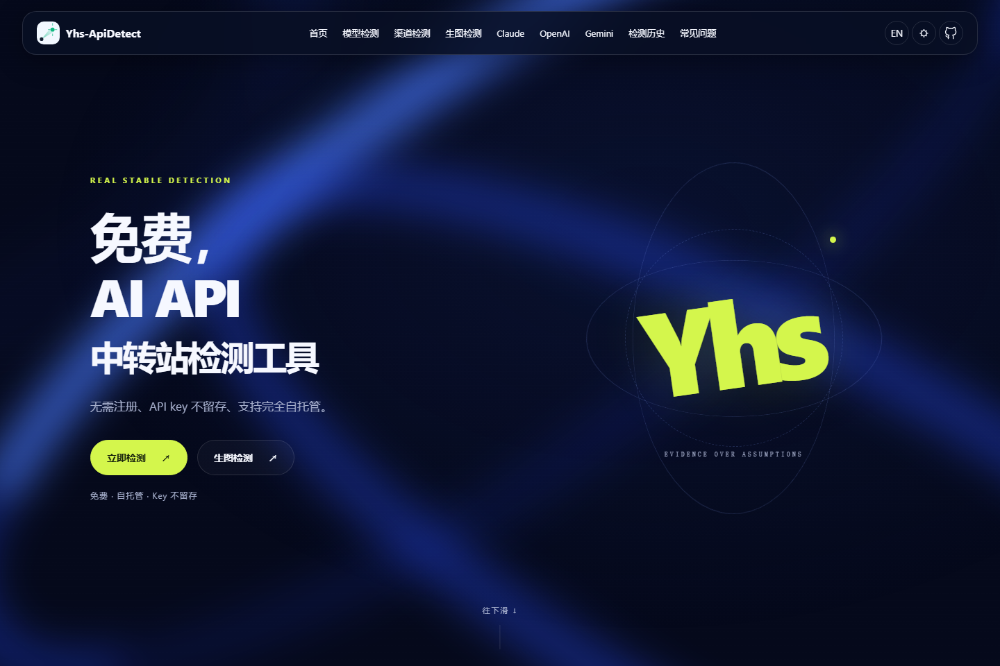
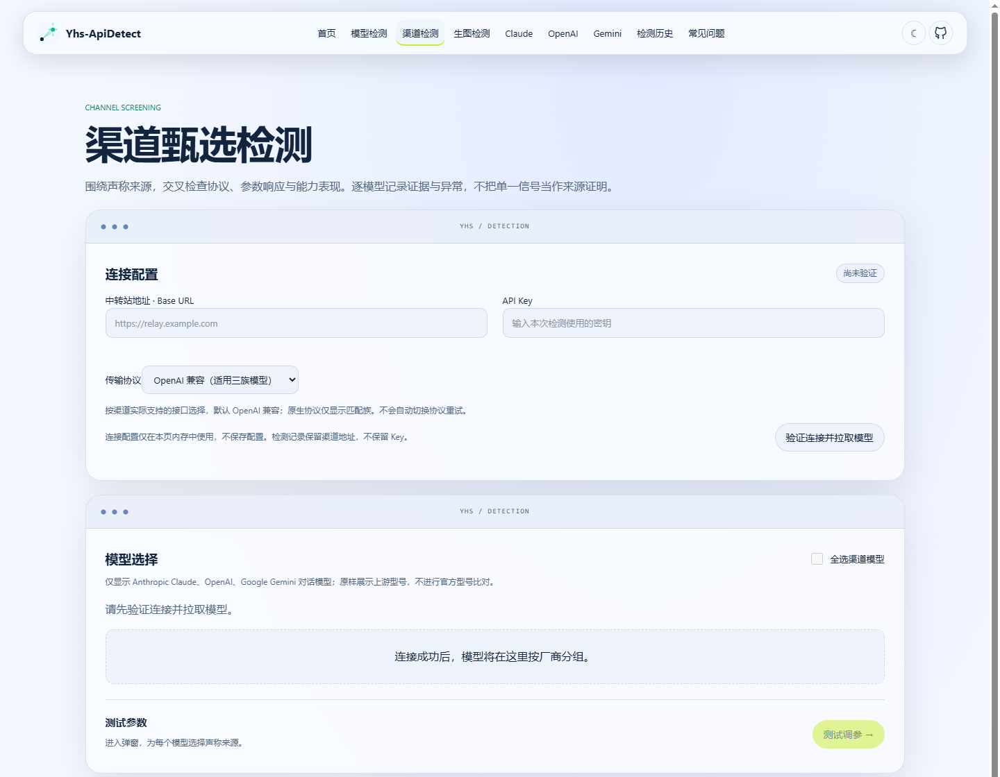
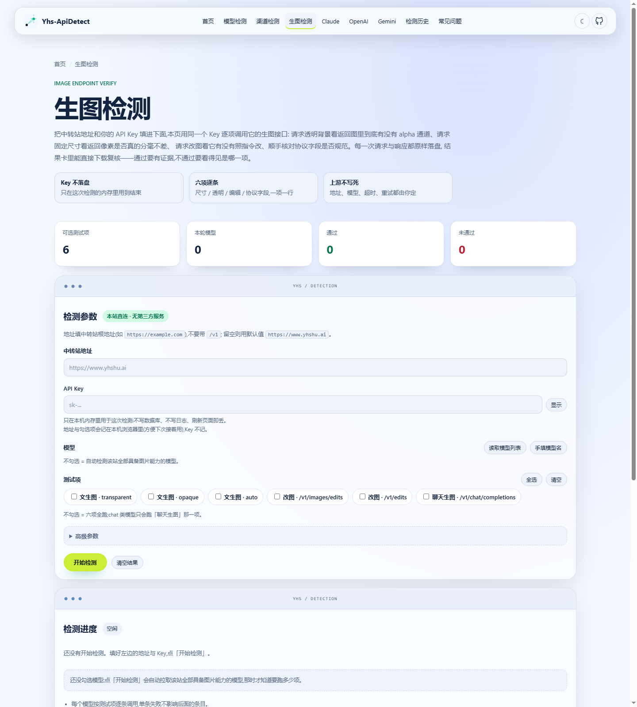

# Yhs-ApiDetect

**看清 API 的表现，不只听它自报身份。**

面向 AI API 中转端点的开源检测工具。用协议检查、能力探针与可复核报告，帮助开发者排查接入问题，比较同条件下的接口表现，并核对渠道的来源声明。

**Anthropic Messages · OpenAI Chat Completions · Gemini 兼容接口 · 渠道检测 · 图片 API**

[快速开始](#快速开始) · [功能与入口](#功能与入口) · [产品预览](#产品预览) · [结果怎么看](#结果怎么看) · [使用参考](#使用参考) · [安全与部署](#安全与部署)

*项目已有真实页面截图的首屏裁切，非 AI 生成效果图。截图用于展示界面；“免费”指工具本身，目标 API 请求仍可能计费。页面文案不构成来源认证或数据绝不留存的保证。*

> **使用前须知**：仅检测你获授权的端点。高分不是官方模型身份证明；签名字段存在不等于密码学验签。报告反映一次有限样本观测，不保证端点未来表现。

## 为什么使用它

- **接入前检查**：确认响应结构、流式事件、工具调用及结构化输出是否满足当前规则。
- **异常时定位**：区分能力不支持、参数不兼容、超时、额度不足与可疑信号，先看证据再下结论。
- **结果可复核**：查看分项结果、JSON 报告和图片证据，而不是只得到一个总分。
- **本机可运行**：提供 Web 页面与 CLI；数据目录可配置，适合自行管理访问权限和记录。

## 功能与入口

| 想做什么 | 入口 | 得到什么 |
| --- | --- | --- |
| 检查 Claude 接口 | /claude；CLI detect | 身份/行为线索、thinking 字段、PDF、工具、协议与用量检查 |
| 检查 OpenAI 接口 | /openai；CLI detect | Chat Completions 的基础响应、model、工具、结构化输出与用量检查 |
| 检查 Gemini 兼容接口 | /gemini；CLI detect | OpenAI 兼容路径检查；该入口不调用原生 generateContent |
| 管理渠道并巡检 | /authenticity | 保存渠道配置、选择声称来源、单次检测及全量巡检 |
| 临时筛选多个模型 | /channel | 连接验证、模型选择、逐模型来源声明、证据与 CSV/JSON/MD 导出 |
| 检查生图和改图 API | /image | 生成、透明背景、尺寸、编辑及聊天生图的分项结果 |
| 回看或分享结果 | /history、/r/{job_id} | 本机历史、报告页、JSON 与报告图片 |
| 浏览聚合与辅助入口 | /leaderboard、/batch、/faq | 榜单、批量页及常见问题；以页面实际交互为准 |

这些路径属于你启动的本地 Web 服务，不代表任何公网实例已经部署或可用。普通文本、渠道真实性、独立渠道、图片检测是不同工作流，不能混用评分。

## 快速开始

需要 **Python 3.10+**。在本项目根目录运行；仅安装和打开页面不会自动执行目标模型检测。

### 1. 安装

**Windows PowerShell 7**（直接调用虚拟环境，无需更改执行策略）：

~~~powershell
python -m venv .venv
& ./.venv/Scripts/python.exe -m pip install -e '.[dev,web]'
& ./.venv/Scripts/relay-detector.exe --help
~~~

**macOS / Linux**：

~~~bash
python3 -m venv .venv
source .venv/bin/activate
python -m pip install -e '.[dev,web]'
relay-detector --help
~~~

仅需命令行时可安装核心依赖：python -m pip install -e .。依赖及命令别名以 [项目配置](pyproject.toml) 为准。

### 2. 启动 Web

**Windows PowerShell 7**：变量名含连字符，使用花括号语法。

~~~powershell
${env:Yhs-ApiDetect_JOBS_DIR} = './web_data/jobs'
${env:Yhs-ApiDetect_AUTHENTICITY_DIR} = './web_data/authenticity'
& ./.venv/Scripts/python.exe -m uvicorn web.server:app --host 127.0.0.1 --port 8765 --workers 1
~~~

**macOS / Linux**：变量名含连字符，使用 env 传入，不使用 export 赋值。

~~~bash
env 'Yhs-ApiDetect_JOBS_DIR=./web_data/jobs' \
    'Yhs-ApiDetect_AUTHENTICITY_DIR=./web_data/authenticity' \
    .venv/bin/python -m uvicorn web.server:app --host 127.0.0.1 --port 8765 --workers 1
~~~

打开 http://127.0.0.1:8765/ 。健康检查地址为 http://127.0.0.1:8765/healthz 。任务状态在进程内管理，先使用单 worker；不要把此开发配置直接暴露公网。

### 3. 执行首次检测

选择协议页面，输入有权调用的基址与 Key，选择目标模型，先从 quick 开始。提交前确认调用费用；结束后优先查看错误、跳过原因及分项证据。

喜欢命令行？先在本机安全配置相应环境变量，再执行：

~~~bash
relay-detector detect --protocol anthropic --model YOUR_MODEL_ID --mode quick -o report.json
~~~

YOUR_MODEL_ID 是占位符，必须替换。Anthropic 使用 ANTHROPIC_BASE_URL / ANTHROPIC_API_KEY；OpenAI 使用 OPENAI_*；Gemini 使用 GEMINI_*。不要把真实 Key 写进截图、共享终端历史或提交记录。自定义模型别名建议显式指定 --protocol。

## 产品预览

以下为项目内已有页面截图，仅展示界面，不是本轮真实 API 检测记录。截图中的域名为页面默认值或占位值，不是推荐服务商。

### 渠道甄选：从连接到逐模型证据

*展示连接配置和模型选择区域；截取自完整页面，不展示下方历史记录状态。*

打开 /channel → 选择传输协议并验证连接 → 勾选模型 → 在“测试调参”中选择声称来源 → 确认费用后开始检测。完成后查看证据、按时间或地址筛选记录，导出 CSV、JSON 或 MD。

默认 OpenAI 兼容传输适用于三族模型；原生传输限定相应模型族。**传输协议不等于声称来源**，模型列表也不是官方型号认证。连接状态不保存为渠道配置，历史记录仍会落盘。详细操作、结论阈值和数据边界见 [渠道检测说明](docs/channel-detection.md)。

### 图片接口：检查生成与编辑是否符合请求

打开 /image，填写授权端点，从目标读取候选或手动输入模型，选择需要检查的阶段后提交。可检查透明/不透明/自动背景生成、两种编辑路径及聊天生图；只选编辑时可能额外生成原图。**这不是识别图片是否由 AI 生成的工具。**

结果保留分阶段状态和图片证据；失败时先区分接口不支持、格式错误、余额不足与落盘失败。图片、提示词和响应可能敏感，分享前检查。

### 配置巡检与检测报告

需要保存多个渠道并重复检查时，使用 /authenticity：保存地址、来源和模型配置，重新提供 Key 后运行单渠道或全量检测。此功能与 /channel 的临时筛选和记录相互独立。

普通文本检测完成后，可从 /history 打开报告，或获取 /api/result/{job_id}.json 与 /r/{job_id}.jpg。报告链接依赖服务可访问及数据仍保留，不保证永久有效。本文没有采用旧版字体测试报告图，以免把模拟分数当成真实产品检测结果。

## 结果怎么看

**先看运行是否有效，再看分项证据，最后看总分。**

| 状态 | 读法 |
| --- | --- |
| pass | 该项样本满足当前规则，不代表全能力认证 |
| fail | 该项规则未通过，结合响应和参数复查 |
| skip | 模式未选择、模型不适用或开关未启用，不计入总分分母 |
| error | 执行错误；不能等同于造假，当前文本评分仍可能受其影响 |

文本总分按非 skip 项加权平均；≥70 为 passed，50–<70 为 marginal，低于 50 为 failed；严重问题可把 passed 封顶为 marginal。渠道与图片有独立规则，不直接横向比较。

quick / standard / full 的候选数量分别为：Claude 5/9/12，OpenAI 3/7/8，Gemini 3/7/7。候选数不等于请求数；长上下文仍需显式启用，可能消耗大量 token。

不能从本工具单独推导：官方身份、物理直连、真实订阅来源、完整计费真实性或未来稳定性。thinking 签名检查目前是字段存在性与长度检查，不是独立密码学验签。

## 使用参考

为保持首页易读，具体检测项和接口参考折叠在下方；展开即可查看。

文本检测项、权重、长上下文与渠道真实性

## 检测能力

检测器权重与模式应以 [Anthropic 配置](src/relay_detector/protocols/anthropic/config.py)、[OpenAI 配置](src/relay_detector/protocols/openai/config.py) 和 [Gemini 配置](src/relay_detector/protocols/gemini/config.py) 为准。下面的权重是配置值，不是某项对总分的固定百分比：有效项会因模式、模型适用性及 `skip` 而变化。

### Claude（Anthropic Messages）：12 个候选项

| 类别 | 检测器 | 权重 | 重点 |
| --- | --- | ---: | --- |
| 信号 | `identity` | 5 | 响应里的模型与身份线索，不能单独鉴真 |
| 信号 | `behavioral_signature` | 15 | 多题行为指纹 |
| 信号 | `thinking_signature` | 25 | 检查 thinking 块签名**存在且长度合理**，不独立验签 |
| 信号 | `consistency` | 10 | 返回 model 与多次响应的一致性 |
| 信号 | `knowledge` | 10 | 特定知识题的响应 |
| 能力 | `pdf` | 8 | PDF 输入与内容提取 |
| 能力 | `structured_output` | 12 | `tool_use` 的结构和 schema |
| 协议 | `protocol` | 5 | 响应字段、内容块与流式事件 |
| 协议 | `integrity` | 5 | 流式与非流式行为 |
| 协议 | `message_id` | 5 | 消息与工具 ID 形态 |
| 协议 | `token_usage` | 10 | 用量字段合理性 |
| 可选 | `long_context` | 15 | 长上下文多层探针，默认跳过 |

`thinking_signature` 是较强的结构信号，但当前实现**没有用官方公钥独立验证签名真伪**；不能写成“数学证明中转站直连”。其权重为 25；默认长上下文跳过时也不等于固定占总分 25%。

### OpenAI（Chat Completions）：8 个候选项

| 类别 | 检测器 | 权重 | 重点 |
| --- | --- | ---: | --- |
| 基础 | `basic_request` | 15 | 最小合规请求和响应 |
| 基础 | `model_consistency` | 15 | model 字段及重复响应 |
| 能力 | `function_calling` | 15 | `tool_calls` 结构与调用标识 |
| 能力 | `structured_output` | 15 | 严格 JSON schema 输出 |
| 协议 | `protocol` | 15 | 响应/SSE 字段和异源 usage 痕迹 |
| 协议 | `integrity` | 15 | 流式/非流式一致性 |
| 协议 | `token_billing` | 10 | 用量及计费字段异常 |
| 可选 | `long_context` | 15 | 长上下文探针，默认跳过 |

异源 usage 字段等问题可能被判为 `critical` 并封顶总判定；应检查具体报告证据，不能仅凭某一个字段推断真实供应商。`token_parity` 的代码存在，但**未注册为默认计权检测器**，不可算作第 9 项或声称默认独立运行。上述检测走 Chat Completions；另有 CLI `openai validate` 用于校验已有原始响应，不等同于调用 `detect`。

### Gemini（OpenAI 兼容接口）：7 项

| 类别 | 检测器 | 权重 | 重点 |
| --- | --- | ---: | --- |
| 基础 | `basic_request` | 15 | 最小合规请求 |
| 基础 | `model_info` | 15 | model 字段和一致性 |
| 能力 | `function_calling` | 15 | 工具调用结构及 thinking 适配 |
| 能力 | `structured_output` | 15 | JSON schema 结构化输出 |
| 协议 | `protocol` | 15 | 响应字段与流式事件 |
| 协议 | `integrity` | 15 | 流式/非流式一致性 |
| 协议 | `token_usage` | 10 | usage 字段合理性 |

本路径检测的是**Gemini 的 OpenAI 兼容 API**，不是原生 `generateContent`；目标站仅有原生接口时不能照此配置硬套。Gemini 的 `standard` 和 `full` 当前均映射这 7 项。

### 跨协议加测：长上下文

Claude 与 OpenAI 的 `long_context` 需要明确启用；Gemini 当前未配此项。探针逐级提高输入规模并检查特定信息是否仍被找回，层间失败会影响后续执行；实际层数、token 规模取决于模型和选项，**不要把示例档位或历史报价当成费用承诺**。CLI 使用 `--long-context` 或 `--long-context-extreme`；极限档可能消耗大量 token，启用前应查看模型上下文窗口、单价、额度和目标端点限制。超时或被限流不等于证明窗口造假。

### 渠道真实性检测（`/authenticity`）

为渠道配置声称来源和模型，再按所选目标运行测试。支持的声称来源枚举由 `GET /api/authenticity/sources` 返回，目前包含 Claude 官方、Claude Code + Max、AWS Bedrock、AWS Partner、Amazon Q / Kiro、Vertex AI（Claude）、OpenAI 官方、Azure OpenAI、Google AI Studio、Vertex AI（Gemini）等选项。服务端保存渠道配置和检测记录；**每次检测仍需提供 Key**，保存配置并不保存 Key。更新配置时若客户端提交 `version`，服务端执行乐观锁校验；未提交版本不触发该冲突校验。

| 信号 | 权重 | 观察范围 |
| --- | ---: | --- |
| `capability` | 40 | 能力题表现 |
| `identity` | 18 | 响应身份与声称来源族 |
| `error_injection` | 12 | 错误状态、错误码及响应结构 |
| `thinking_signature` | 10 | Claude thinking 签名字段等，不等同密码学验签 |
| `model_echo` | 8 | 响应 model 与目标的关系 |
| `parameter_validation` | 7 | 越界参数的拒绝形态 |
| `cache` | 5 | 缓存相关字段和行为 |

| 结果 | 通常阈值 | 解释 |
| --- | --- | --- |
| `authentic` | 分数 ≥ 80 | 当前证据与声称来源相符，不是来源的官方证明 |
| `suspect` | 50 ≤ 分数 < 80 | 存在疑点，需要复核；身份冲突时高分也可能封顶为此态 |
| `fail` | 分数 < 50 | 当前规则不通过，排除配置错误后再判断 |
| `error` | 传输级故障 | 连接/超时等失败优先，不应计为造假 |

不适用信号不计入有效权重；报告同时提供置信相关信息。统计应检查分母：`error` 不进入 `authentic + suspect + fail` 的有效检测数；页面/接口可能展示跨族合计，解读时仍应分协议族查看明细。配置来源要显式选择，模型与声称来源跨族会拒绝；模型留空的自动选择仍受同族可用模型约束。检测任务只读取已保存的渠道配置，不应把填写表单但未保存的改动视为已生效。

图片检测阶段、接口与证据目录

## 图片检测

图片检测是与文本、渠道真实性并列的**独立 Web 功能**：向已授权的图片 API 发送真实生图/改图请求并检查返回证据，**不用于识别现成图片是否 AI 生成**，也不参与上文文本加权评分。实现入口见 [图片检测逻辑](web/image_detect.py) 与 [图片作业](web/image_jobs.py)。

### 六种可选择的阶段

| 阶段 | 请求路径 | 核查要点 |
| --- | --- | --- |
| 文生图 · transparent | `/v1/images/generations` | 期望透明背景、图片尺寸与 PNG 格式 |
| 文生图 · opaque | `/v1/images/generations` | 期望不透明背景、尺寸与 PNG |
| 文生图 · auto | `/v1/images/generations` | 记录实际透明情况，不强制透明/不透明 |
| 改图 · images/edits | `/v1/images/edits` | 输入原图后检查编辑结果 |
| 改图 · edits 别名 | `/v1/edits` | 检查另一路编辑接口 |
| 聊天生图 | `/v1/chat/completions` | 从聊天响应解析图片，核对图片格式和尺寸 |

仅选择改图时作业会**额外自动生成原图**供编辑，该准备步骤不是第七个用户勾选阶段。目标 API 未实现某一接口、返回非预期格式或余额不足，都可能导致相应阶段失败；不能由此推断另一个接口也不可用。默认输出要求、模型选择及每项判定以页面和代码为准。

### 操作与结果

1. 按上文启动 Web，打开 `http://127.0.0.1:8765/image`，填写有权调用的目标基址及 API Key。
2. 从目标拉取图片模型候选，或手动输入模型；选择实际支持的阶段并确认可能的调用费用，再提交检测。
3. 在页面查看状态、各阶段错误/结果和图片证据；历史只反映本机保存的作业，不代表全网模型能力。

| 接口 | 方法 | 用途 |
| --- | --- | --- |
| `/api/image/models` | POST | 查询目标的图片模型候选 |
| `/api/image/run` | POST | 发起检测；已有活动任务时返回 409 |
| `/api/image/task_status?task_id=...` | GET | 轮询当前任务状态 |
| `/api/image/evidence/{task_id}/{name}` | GET | 读取对应证据文件 |
| `/api/image/history` | GET | 查询本机历史 |

证据目录由 `Yhs-ApiDetect_IMAGE_DIR` 指定，默认仓库内 `web_data/image`；每次作业可写入请求/响应记录、生成图片与 `run.json`，目录还有 `history.jsonl`。证据写盘失败时内存结果仍可能存在，不能把“接口返回成功”当作落盘成功。保存及分享前审查提示词、原始图片、目标 URL 是否敏感；目前任务对象在内存保留运行所需 Key，设计上不向证据写 Key，但**不能保证每个第三方响应字段都已彻底脱敏**。首次运行前检查数据目录权限、模型报价与预算；本说明未向真实付费图片端点发请求。

评分公式与运行模式

## 评分体系

常规文本评分实现见 [评分器](src/relay_detector/core/scorer.py)。计算式：

~~~text
total_score = Σ(非 skip 检测器.score × 对应权重) / Σ(非 skip 检测器权重)
~~~

`skip` 不进入分母；`error` 与 `skip` 不相同，传输故障可能影响分数。有效项为零时的零分不应解释为模型真实性得零分。报告里的 `issues`、跳过原因、模型与模式比总分更重要。

| 分数 | 基础 verdict | 展示意义 |
| --- | --- | --- |
| ≥ 85 | `passed` | 展示可标为“优秀”，仍不证明官方来源 |
| 70–<85 | `passed` | 当前规则通过 |
| 50–<70 | `marginal` | 需复查异常项 |
| <50 | `failed` | 当前规则未通过，先排除运行错误 |

严重问题（如非跳过项的 `critical_issue_count` 或 `critical` issue）可将本来通过的 verdict 封顶为 `marginal`；账单/渠道异常等整次运行问题可使检测无效。不同协议、模式或被跳过项组合的分数不能不看权重就横向排序。**此评分与上一节渠道真实性的 80/50 阈值不是同一体系。**

### 三档模式

| 模式 | Claude 候选项 | OpenAI 候选项 | Gemini 候选项 |
| --- | ---: | ---: | ---: |
| `quick` | 5 | 3 | 3 |
| `standard` | 9 | 7 | 7 |
| `full` | 12 | 8 | 7 |

`full` 包括 Claude/OpenAI 的 `long_context` 候选项，但默认仍自跳过，需显式选用。请求次数、耗时及实际账单受重试、模型、网络和价格影响，旧文档里的固定时间/美元估计不能作为承诺。

CLI 命令与环境变量

## CLI 参考

`relay-detector` 与 `Yhs-ApiDetect` 是同一 CLI 入口；以本机 `--help` 为最新参数依据。下面特别区分只读本地与真实网络操作。

| 命令 | 用途 | 是否对目标发请求 |
| --- | --- | --- |
| `relay-detector version` | 显示程序版本 | 否 |
| `relay-detector ping --model ...` | Anthropic Messages 基本连通性 | 是 |
| `relay-detector detect --protocol ... --model ...` | 运行探针、可输出 JSON | 是，多次 |
| `relay-detector compare report.json` | 对现有 Anthropic 报告与基线比较 | 否 |
| `relay-detector openai validate response.json` | 本地校验已有 OpenAI 响应 JSON | 否 |
| `relay-detector openai baseline` | 主动采集 OpenAI 基线 | 是，可能计费 |

`detect` 常用参数有 `--base-url`、`--api-key`（优先用环境变量）、`--model`、`--protocol anthropic|openai|gemini`、`--mode quick|standard|full`、`--max-concurrent`、`--timeout`、`--output/-o` 与可选长上下文开关。模型名通常可用于推断协议，但自定义或中转别名模型应明确写 `--protocol`。

`compare` 的报告文件是位置参数；`--baseline/-b` 可指定基线文件，也可用默认 `data/baselines` 中与模型、模式匹配的文件。不要拿 quick 报告去与 full 模式基线直接比较。`openai validate` 的 `--wire-api` 可区分 `responses` 与 `chat-completions`；`openai baseline` 发网络探针，阅读文档或运行普通测试无需调用它。

环境变量：Anthropic 使用 `ANTHROPIC_BASE_URL`、`ANTHROPIC_API_KEY`、`ANTHROPIC_MODEL`；OpenAI 使用对应 `OPENAI_*`；Gemini 使用 `GEMINI_*`。配置应使用你已获授权的地址和模型；每次检测以运行时输出为准。

Web 接口与环境变量

## Web 端

Web 入口实现于 [web/server.py](web/server.py)，由 FastAPI、Jinja2 与静态资源构成；没有前端构建命令。页面路径为**本地服务相对路径**，不要把它们误读为已部署公网地址。

| 页面 | 说明 |
| --- | --- |
| `/`、`/claude`、`/openai`、`/gemini` | 首页与三协议检测页 |
| `/authenticity` | 声称来源的渠道真实性检测 |
| `/image` | 图片 API 生成与编辑检测 |
| `/history`、`/r/{job_id}` | 本机已有报告索引与报告页 |
| `/faq`、`/healthz` | 常见问题与健康检查 |

其他页面/辅助资源包括榜单、批量页、报告图片 `/r/{job_id}.jpg` 与部分 SEO 站点文件；以服务路由为准。常规异步作业使用 `POST /api/detect`（及分协议入口）、`POST /api/probe`、`GET /api/status/{job_id}`、`GET /api/result/{job_id}.json`。作业在进程内管理，报告落在 `Yhs-ApiDetect_JOBS_DIR`；多 worker 会分离内存状态，建议单 worker。链接仅在服务可访问、对应数据仍被保留时有效，**不保证永久可分享**。

### 渠道真实性 API

| 接口 | 方法 | 用途 |
| --- | --- | --- |
| `/api/authenticity/sources` | GET | 获取声称来源选项 |
| `/api/authenticity/config` | GET / POST | 读取配置 / 添加渠道 |
| `/api/authenticity/config/{channel_id}` | PUT / DELETE | 更新（可携 version）/ 删除配置 |
| `/api/authenticity/config/{channel_id}/enabled` | PUT | 启停单渠道 |
| `/api/authenticity/config/batch` | POST | 批量启停 |
| `/api/authenticity/models` | POST | 查询目标模型 |
| `/api/authenticity/test/{channel_id}` | POST | 单渠道即时检测 |
| `/api/authenticity/test_all` | POST | 异步全量巡检；重复任务可返回 409 |
| `/api/authenticity/task_status` | GET | 查看巡检进度 |
| `/api/authenticity/report`、`/api/authenticity/report/export` | GET | 聚合报告 / CSV 导出 |
| `/api/authenticity/records` | GET | 检测记录明细 |

请求体字段请以页面表单和路由校验为准；**接口存在不等于已做公开访问鉴权**。图片专项的接口见上文独立章节。

### 常见环境变量

| 变量 | 作用与注意事项 |
| --- | --- |
| `Yhs-ApiDetect_JOBS_DIR` | 普通检测报告目录；代码中生产默认路径为 `/opt/Yhs-ApiDetect/web_data/jobs`，本地需选可写路径 |
| `Yhs-ApiDetect_AUTHENTICITY_DIR` | 渠道配置、记录目录；默认位于 `/opt/Yhs-ApiDetect/web_data/authenticity` |
| `Yhs-ApiDetect_AUTHENTICITY_CONFIG` | 覆盖渠道配置文件路径 |
| `Yhs-ApiDetect_IMAGE_DIR` | 图片任务和证据目录；默认项目内 `web_data/image` |
| `Yhs-ApiDetect_WISHLIST_PATH` | 覆盖愿望单数据文件 |
| `RELAY_DETECTOR_HOST`、`RELAY_DETECTOR_PATH` | 部署脚本的远端主机与目标目录；与 Web 运行变量无关 |

## 安全与部署

工具免费不代表目标 API 免费。长上下文、图片、基线采集及全量巡检都可能产生费用；仅对授权端点使用，先设置预算和最小检测范围。

Key 在运行所需生命周期内使用，不应进入公开记录；报告、渠道记录和图像证据确实会落盘。不要把“不保存 Key”扩大为“所有数据不留存”。第三方响应可能回显敏感内容，发布报告前人工审查。

| 数据 | 目录配置 | 注意 |
| --- | --- | --- |
| 文本报告 | Yhs-ApiDetect_JOBS_DIR | 本地启动时显式设置可写目录 |
| 渠道真实性配置与记录 | Yhs-ApiDetect_AUTHENTICITY_DIR / Yhs-ApiDetect_AUTHENTICITY_CONFIG | 配置保存不等于 Key 保存 |
| 独立渠道记录 | Yhs-ApiDetect_CHANNEL_DIR；默认 web_data/channel | SQLite 记录包含地址与证据 |
| 图片与请求响应证据 | Yhs-ApiDetect_IMAGE_DIR；默认 web_data/image | 图像与提示词可能敏感 |

这些环境变量含连字符：PowerShell 使用 ${env:变量名}，POSIX 使用 env '变量名=值' command。公开部署前配置 HTTPS、访问控制、网络访问约束、费用限制及数据保留策略；已有路由不等于具备多用户隔离。

任务状态在内存中，进程重启不保证恢复未完成任务；已落盘记录另行保留。备份与同步必须独立审核排除规则，Git 忽略规则不等于备份规则。删除历史记录前确认权限、范围和备份。

当前检出未找到旧文档引用的根目录 systemd 示例及 CI 工作流，因此不再提供其链接或宣称当前 CI 状态。部署请依据实际交付文件，而不是依赖旧文档中的脚本名。更多边界见 [安全说明](SECURITY.md)。

## 开发与测试

代码按共享核心与协议实现拆分：

~~~text
src/relay_detector/
  core/                 数据模型、执行与评分
  protocols/            anthropic / openai / gemini
  cli.py                命令行入口
web/                    FastAPI 路由、作业、模板与静态资源
tests/                  自动化测试
docs/                   设计、使用说明与产品配图
~~~

安装开发依赖后执行：

~~~bash
python -m pytest tests/ -q
~~~

Windows 可用 & ./.venv/Scripts/python.exe -m pytest tests/ -q。模拟端点测试不证明真实上游可用，也不代表线上部署验收通过。

新增检测器要同步核对协议模块、注册、权重、模式、模型适用性及通过/失败/跳过/异常测试；不要只修改旧兼容导入。Web 变更还需核对请求校验、状态、持久化和旧报告读取。

故障排查

## 故障排查

| 现象 | 先核对 | 处理建议 |
| --- | --- | --- |
| CLI 命令找不到 | 虚拟环境激活、安装与 `--help` | 用当前环境的 Python 重装本仓库，Windows 核对 Scripts 目录 |
| ping / detect 连接错误或超时 | 目标 URL、协议、模型、TLS、Key、额度和网络 | 用授权端点的小请求排查；**别把超时判成造假** |
| `compare` 找不到基线 | 报告的模型与模式、基线文件名 | 用 `--baseline/-b` 指定匹配文件；不要拿相近模型冒充同一基线 |
| 分数低 / 大量 `skip` | 模式、模型适用性、运行级错误 | 检查每项证据，再决定是否扩大测试 |
| 渠道真实性全量运行返回 409 | 是否已有一个全量任务在运行 | 查询任务状态后再试，不要重复提交 |
| 渠道页提示缺 Key | 当前浏览器页面是否仍留 Key | 刷新会清空页面内存，重新输入；不是去清理 `localStorage` |
| 配置保存 400 / 409 | 来源、模型族是否匹配；是否传过期 `version` | 校正配置或重新读取后带正确版本提交 |
| 图片检测失败或无历史证据 | 阶段接口支持、费用余额、`Yhs-ApiDetect_IMAGE_DIR` 写权限 | 区分阶段失败、任务失败与落盘失败；审查日志和对应目录 |
| 报告链接失效 | 对应作业是否完成、本机数据是否保留 | 核对 `/api/status/{job_id}`、作业目录、服务进程 |
| `InvalidURL: Invalid port: ':1]'` | `NO_PROXY` 中的 `[::1]` | 查看程序修复日志，必要时清理该条目并重试 |
| 长上下文探针跳过 | 是否显式传开关、目标协议与模型是否支持 | 先确认预算，再启用 `--long-context`；Gemini 当前未配置该探针 |

某些中转站给模型名加 `-thinking` 后缀，可能与工具选择或 thinking 参数冲突，导致结构化输出项报 400；先从**真实响应和可用模型列表**确认目标支持的参数，不应机械删后缀并宣称问题必然解决。持续运行中的任务先查状态及日志，不要清空在用作业目录。

Anthropic 历史协议兼容线索

## 已知 Anthropic 协议漂移

下面是项目历史问题对应的**兼容处理线索**，不是本次对官方当前 API 的联网实测，也不是断言“恰好七处且全部已解决”。模型版本更新后应重新核对 [Anthropic 客户端](src/relay_detector/protocols/anthropic/client.py)、[模型配置](src/relay_detector/protocols/anthropic/config.py) 和 [thinking 检测器](src/relay_detector/protocols/anthropic/detectors/thinking_signature.py)。

| 线索 | 检查方向 |
| --- | --- |
| 请求 ID header 的可用性变化 | 不要将某个 header 缺失直接当模型造假；检查当前协议响应 |
| 模型自报知识截止时间 | 自报身份/截止时间不是稳定的独立鉴真依据 |
| `tool_use.caller` 形态变化 | 观察真实字段结构，避免强制按字符串解析 |
| Opus 4.7 / 4.8 的 `temperature` 支持 | 客户端按模型选择参数；异常以实际响应定位 |
| thinking `enabled+budget_tokens` 与 adaptive | 按当前模型配置选择，不沿用旧稿对单一模型的断言 |
| `effort` 参数位置 | 核对 `output_config.effort` 与服务端支持情况 |
| streaming 与非 streaming 的 thinking 块 | 对比两种响应；某些适配逻辑使用非流式观察 |

变更清单不能替代版本化官方接口说明，也不保证中转端点与官方响应完全相同；若失败，保存原始错误、模型 ID 与调用参数再修订兼容层。

## 文档导航

- [技术设计与演进基线](DESIGN.md)：当前架构、证据边界及待实施优化。
- [渠道检测使用说明](docs/channel-detection.md)：临时渠道筛选的完整操作。
- [OpenAI 协议验证](OPENAI_API_PROTOCOL_VALIDATION.md)：离线校验与基线说明。
- [多协议重构背景](docs/REFACTOR_v2_PROTOCOLS.md)：历史设计，不等同当前实现。
- [贡献指南](CONTRIBUTING.md)、[变更记录](CHANGELOG.md)、[安全说明](SECURITY.md)。
- [截图来源](docs/images/README.md)：配图原始来源、裁切与展示边界。

## 许可

采用 [AGPL-3.0-or-later](LICENSE)。使用、修改和通过网络提供服务时，请阅读许可证要求；第三方素材按其自身许可处理。静态资源来源见 [资源授权说明](web/static/ASSET-CREDITS.md)。
